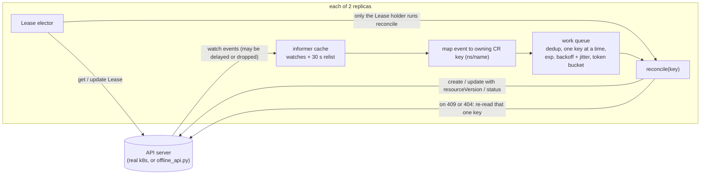
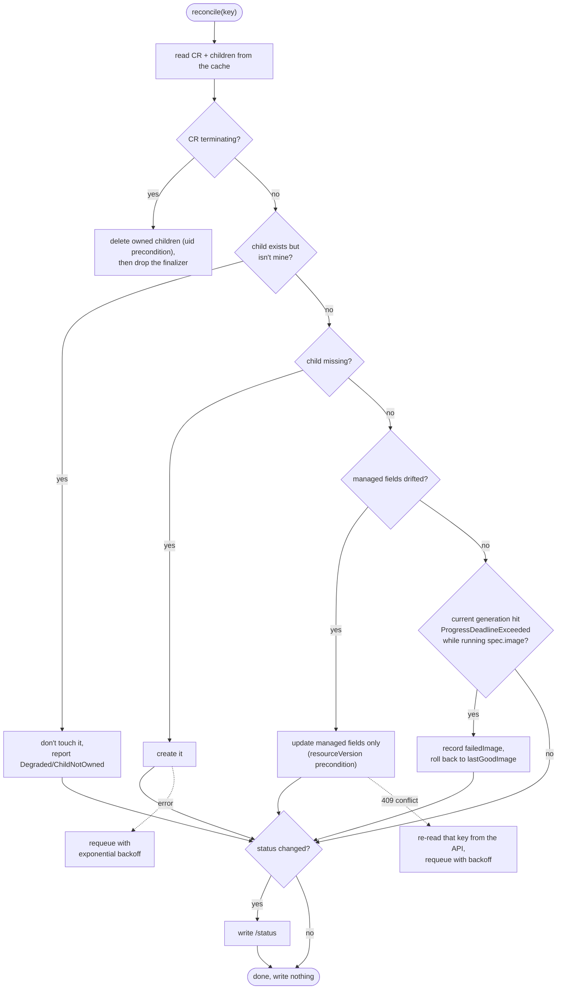
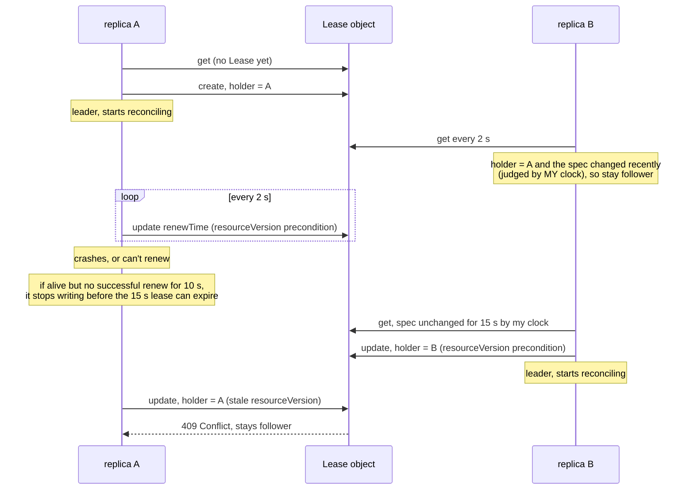
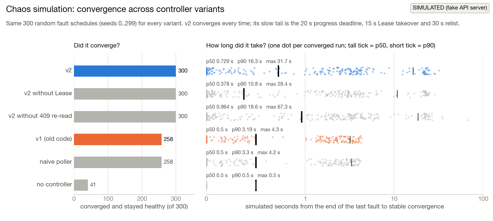
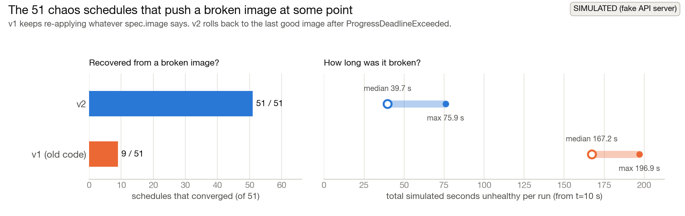
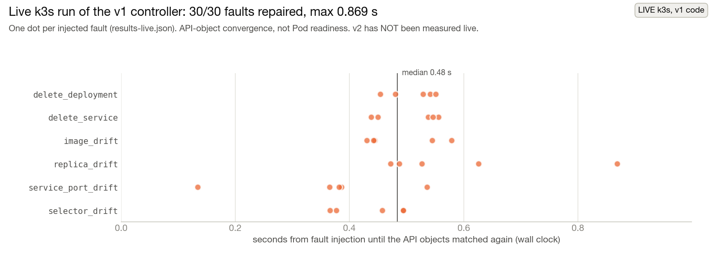

# Inference Deployment Recovery Operator

*I kept deleting my own Deployment by accident while messing around with a local k3s cluster,
so I built the thing that puts it back.*

A small Kubernetes operator in Python. You describe an `InferenceService` (image, replicas,
port), and it keeps a matching Deployment and Service alive: it recreates them if they're
deleted, undoes edits to the fields it manages, refuses to touch objects it doesn't own, and
rolls back an image that never becomes available. "Inference" is aspirational. The sample image
is nginx, and this project is about keeping the objects right, not about serving models.

### TL;DR

There are two kinds of evidence here and I keep them apart:

- **Live k3s, old v1 code** (`results-live.json`): **30/30** injected deletion and drift faults
  repaired, max **0.869 s**.
- **Simulated, new v2 code** (`results-chaos.json`, 300 random fault schedules on a fake API
  server): v2 converged and stayed healthy in **300 / 300** runs with every invariant held, vs
  **258 / 300** for the v1 code in the same simulator.
- **Simulated:** on the **51** schedules that push a broken image, v2 recovered in **51 / 51**
  and v1 in **9 / 51**, because v1 can't roll back.
- **Simulated:** v2 never wrote to an object it didn't own (**0** runs), vs **63** runs for a naive
  poller that adopts look-alike objects. v2 has **not** been run against a real cluster yet.

## Two versions, two kinds of evidence

| | v1 (Oct 2026) | v2 (this version) |
|---|---|---|
| loop | poll every 0.5 s, direct GETs | watches → informer cache → rate-limited work queue |
| writes | blind JSON patches | full updates with a `resourceVersion` precondition (409 on stale reads) |
| ownership | refuses unowned objects | same, plus reports it in status (`Degraded/ChildNotOwned`) |
| replicas | one | two, with Lease leader election |
| status | none | `observedGeneration`, `Ready`/`Progressing`/`Degraded` conditions |
| deletion | relies on ownerReference GC | finalizer that deletes only owned children (uid precondition) |
| bad images | keeps applying them forever | rolls back to last good image after `ProgressDeadlineExceeded` |
| evidence | **real k3s run** (`results-live.json`) | **offline simulation** (`results-chaos.json`, `results-offline.json`) |

The v1 code is frozen in `v1/` because it's what produced the live numbers.

## Architecture (v2)



## What I built

- **A level-triggered reconciler** (`controller.py`) shared by the simulator and the live
  runtime. It never looks at *which* event happened, only at the current state.
- **A client-go style runtime**: informer cache with a periodic relist, and a rate-limited work
  queue with dedup, per-key exponential backoff with jitter and a token bucket (`workqueue.py`).
- **Lease leader election** (`leader.py`) for two replicas, judged by when *I* last saw the Lease
  change rather than by the other replica's clock.
- **Optimistic concurrency**: every update carries the `resourceVersion` I read, so a concurrent
  write gives a 409 instead of being silently overwritten.
- **Managed-fields-only drift repair**: replicas, image, container port, progress deadline, the
  Service selector and ports. Annotations, env vars and anything else someone adds survive.
  (This isn't real server-side apply. It's a hand-written version of the same idea.)
- **Ownership checks**: an object with my name that I don't control is never touched; it's
  reported as `Degraded/ChildNotOwned`.
- **Status subresource** with `observedGeneration` and `Ready`/`Progressing`/`Degraded`
  conditions, written only when something changed.
- **Image rollback** to the last good image after `ProgressDeadlineExceeded`.
- **A finalizer** that deletes only owned children, with a uid precondition.
- **A chaos harness**: a fake API server on a simulated clock (`offline_api.py`), a random
  fault-schedule generator and an invariant checker (`chaos.py`), plus baselines (`baselines.py`).
- **A live adapter** (`k8s_adapter.py`) using the official kubernetes Python client, and a
  30-fault live evaluator (`evaluate_live.py`).

## How it works

### The reconcile loop



A few decisions and why:

- **Level-triggered.** Reconcile never looks at *what* event happened, only at the current
  state. A dropped event costs time, not correctness, because the periodic relist re-enqueues
  everything.
- **Optimistic concurrency instead of locks.** If anyone wrote between my read and my write, I
  get a 409 and try again, instead of silently overwriting their change.
- **Status writes only when something changed.** `lastTransitionTime` only moves when a
  condition flips. Otherwise every status write would trigger an event, which triggers a
  reconcile, which writes status again.
- **Rollback rule:** if the Deployment for the *current* generation reports
  `ProgressDeadlineExceeded` while running `spec.image`, I record it as `failedImage` and go
  back to `lastGoodImage`. Pushing a different image clears it. A drifted image that fails is
  never blamed on the spec.

### Leader election

Two replicas for availability, but only one writer. This mirrors client-go's Lease lock:



The key detail: expiry is judged by when *I* last saw the Lease spec change, not by the
`renewTime` the other replica wrote with its own clock, so clock skew between replicas doesn't
matter.

### The chaos harness

`offline_api.py` is a fake API server on a simulated clock. It has resourceVersions,
generations, a status subresource, finalizers, ownerReference GC, 409s, injected 503s, watch
streams with delays, breaks and silent drops, and a fake Deployment controller (images tagged
`-broken` never become available). `chaos.py` generates a random fault schedule per seed and
runs every controller variant against it:

- deleting the Deployment or Service
- drift in image, replicas, port or selector
- a harmless annotation (bumps resourceVersion)
- user spec changes, including broken images
- a **squatter** (someone deletes my Deployment and creates their own with the same name)
- a **rogue writer** fighting the controller
- windows of 503s (30–100% of requests)
- watch breaks
- **killing the leader**
- deleting the CR

An invariant checker reads the audit log and the object store after every event:

- converges to the healthy state after the last fault and stays there
- never successfully writes to an object it doesn't control
- never writes while not holding the Lease
- at most one owned object per kind
- a hand-made look-alike Deployment is never touched
- at most 50 controller requests in any 1 s bucket (hot-loop check)
- zero writes in the final 30 s once converged

**Variants:**

- `none`: apply the children once, no controller
- `naive`: two pollers, no ownership check, blind patches, 10 ms retry, no leader election
- `v1`: the exact old code, polling
- `v2`
- two ablations of v2: without the Lease, and without the 409 re-read

## Results

The charts are drawn by [`scripts/make_figures.py`](scripts/make_figures.py), which reads only
`results-chaos.json` and `results-live.json`. Each chart carries a **SIMULATED** or **LIVE**
badge so the two kinds of evidence can't get mixed up.

### Simulated: offline chaos runs (new, v2 era, `results-chaos.json`)

Command `python3 chaos.py --seeds 300`, seeds 0–299, every variant on the same 300 schedules.
It took 52.2 s wall / 51.5 s CPU on an M2 MacBook (Python 3.10.8). All times are **simulated
seconds** on the fake API server with assumed latencies (1–5 ms per request, 1–4 s rollouts,
20 s progress deadline, 15 s Lease). They aren't Kubernetes latencies.



| | none | naive | v1 | **v2** | v2 no Lease | v2 no 409 re-read |
|---|---|---|---|---|---|---|
| converged & stayed healthy (of 300) | 41 | 258 | 258 | **300** | 300 | 300 |
| runs with all invariants held | 300 | 166 | 300 | **300** | 299 | 300 |
| runs that wrote to an object they didn't own | 0 | 63 | 0 | **0** | 0 | 0 |
| runs over the hot-loop limit (max req/s) | 0 (0) | 92 (196) | 0 (10) | **0 (26)** | 1 (117) | 0 (31) |
| convergence after last fault p50 / p90 / max (sim s) | 0.5 / 0.5 / 0.5 | 0.5 / 3.302 / 4.1965 | 0.5 / 3.192 / 4.3021 | **0.729 / 16.342 / 31.7351** | 0.378 / 10.835 / 28.423 | 0.964 / 18.551 / 67.2815 |
| time unhealthy from t=10 s, objects only, p50 / max | 194.524 / 233.17 | 10.485 / 196.92 | 14.761 / 196.908 | **15.674 / 75.886** | 20.919 / 73.971 | 16.313 / 93.65 |
| controller API requests per run (median) | 0 | 2,470.5 | 1,197 | **358.5** | 105 | 364 |
| steady-state requests/s (median) | 0 | 11.8 | 5.9 | **1.5835** | 0.2 | 1.567 |
| 409 conflicts (total) | 0 | 0 | 0 | **1,276** | 3,670 | 7,214 |
| max replicas that believed they led at once | — | — | — | **1** | — | 1 |

(Convergence times only cover runs that converged. For "none" that is 41 runs, and 39 of them
are schedules that end by deleting the CR, which ownerReference GC cleans up on its own.)



How to read it:

- Every v1 and naive failure (42 each) is a schedule whose last spec change was a broken
  image. Neither can roll back. In the 51 schedules that pushed a broken image at some point,
  v2 converged in **51/51** and v1 in **9/51**.
- In the 54 schedules that kill the leader, v2's worst total unhealthy time in a run was
  **75.886 s** vs **188.755 s** for v1, which is down until restarted. Medians (objects only):
  21.538 vs 29.724 s.
- v2's slower p90/max convergence comes mostly from waiting out the 20 s progress deadline
  before rolling back, the 15 s Lease takeover, and the 30 s relist after silently dropped
  events. On the broken-image schedules alone, v2's median convergence is 19.083 s: that's the
  deadline.
- v2's request count is mostly Lease renewals (two replicas, every ~2 s). The no-Lease
  ablation shows the reconcile path itself needs about 105 requests per run.
- "naive converges" partly because it adopts squatters: it rewrites someone else's object
  until it looks like ours.

`python3 demo_offline.py` also replays the live evaluator's 30 deletion and drift faults in the
simulator (`results-offline.json`). Both versions repaired 30/30. Median repair was 0.2647 sim-s
for v1 and 0.018 sim-s for v2, and controller requests were 6.01 vs 1.91 per sim-second. The gap
is mostly v1's 0.5 s poll interval, so it says nothing about real latency.

### Live: k3s (old, v1 code, `results-live.json`)

Measured on 30 October 2026 with the **v1 controller** (now in `v1/`) on a one-node Lima/k3s
cluster on macOS arm64 (Python 3.10.8, kubernetes client 35.0.0). I haven't re-run this since:
no cluster right now. **v2 has not been measured live.**



- 30/30 injected deletion and drift faults repaired, max **0.869 s**, median 0.48 s (computed
  from the 30 records)
- at most 2 owned objects (one Deployment, one Service) at any check; no controller errors
- with the controller stopped, a deleted Deployment was still gone after 3 s
- this timing is API-object convergence, not Pod readiness

### What the numbers do NOT show

- **Nothing about v2 on a real cluster.** Every v2 number is from my simulator.
- **Not real latencies.** Simulated seconds come from latencies and timeouts I picked; the live
  numbers are one laptop, one node, v1 only, API objects only.
- **v2 isn't faster at everything.** On median "time spent unhealthy", v1 (14.761 s) is slightly
  better than v2 (15.674 s, objects only), and v2's p90/max convergence is much slower because
  it waits for real signals (progress deadline, Lease expiry, relist).
- **Silent watch drops are adversarial.** Real watches mostly fail loudly and get relisted, so
  the 409 and relist numbers are probably worse than reality, not better.

## What surprised me / bugs the chaos runs found

1. **One dropped event → 30 s of 409s.** My first v2 read everything from the cache. When the
   watch event for *my own* status write got dropped, the cache kept an old resourceVersion,
   and every status write 409'd and backed off until the 30 s relist. Fix: after a 409 (or
   404/AlreadyExists), re-read that one key from the API. The `v2_no_refresh` ablation keeps
   the old behaviour: across the same 300 schedules it hit **7,214** 409s vs **1,276** with the
   fix, and its worst-case convergence was 67.2815 vs 31.7351 simulated seconds.
2. **Forgetting what "good" was.** Seed 72: the "rollout finished" event was dropped, then the
   leader crashed, then the user pushed a broken image. The standby took over and went straight
   to the broken image. It had never recorded v1 as good, so it had nothing to roll back to and
   stayed broken. 2 of 300 ablation runs never converged
   (`results-chaos-before-lastgood-fix.json`). Fix: remember which image I last applied
   (`status.appliedImage`) and mark it good *before* changing it, if it's fully rolled out.
   There's a regression test for this exact sequence.
3. **Two replicas without a Lease ping-pong the status.** In `v2_no_lease` seed 188 one
   replica's cache had missed "rollout complete", so it thought Ready=False while the other
   thought True. They overwrote each other **117 times in one second**. Every write
   *succeeded*, so resourceVersion checks don't help here. That one run is why leader election
   exists.
4. **The boring poller is hard to beat on speed.** v1 does 6 fresh GETs a second and never
   trusts a cache, so lossy watches don't hurt it. v2's wins are elsewhere: rollback, crash
   tail, request count, and never touching things it doesn't own.
5. Smaller ones: the finalizer looped on 404 after the CR was already gone (treat NotFound as
   done). My first invariant check said everything failed because the fake Deployment
   controller writes status on the look-alike object (compare spec, not resourceVersion).

## Run it yourself

**Prerequisites:** Python 3.10+. The operator logic, simulator, tests and chaos harness are
stdlib only. The live mode needs the `kubernetes` client (`requirements.txt`) and a cluster
(k3s, kind or minikube). Redrawing the charts needs matplotlib + numpy.

**Setup:**

```sh
git clone https://github.com/nikhils23j/inference-deployment-recovery-operator.git
cd inference-deployment-recovery-operator
```

**Quickstart (offline, under a second):**

```sh
python3 demo_offline.py          # narrated rollback + crash demo; rewrites results-offline.json
```

**Full offline evaluation (~1 min; the recorded run took 52.2 s on an M2):**

```sh
python3 chaos.py --seeds 300                                      # rewrites results-chaos.json
python3 chaos.py --seeds 20 --variants v2,v1 --output my-run.json # smaller, to a separate file
python3 scripts/make_figures.py                                   # redraw docs/img/*.png
```

To look at one run, `chaos.run_one("v2", chaos.make_schedule(72), record_trace=True)["server"].audit`
gives every request with time, actor, verb and status code.

**Live, on k3s, kind or minikube:**

```sh
python3 -m venv .venv && .venv/bin/python -m pip install -r requirements.txt
kubectl apply -f crd.yaml
kubectl wait --for=condition=Established --timeout=60s crd/inferenceservices.portfolio.nikhil.dev
kubectl apply -f sample.yaml
.venv/bin/python k8s_adapter.py --namespace default        # start a second copy to see the Lease
kubectl get isvc,deploy,svc,lease
kubectl delete deploy demo-inference                       # comes back
kubectl patch isvc demo-inference --type merge -p '{"spec":{"image":"nginx:does-not-exist-broken"}}'
#   ...after progressDeadlineSeconds (60 s in sample.yaml) it should roll back to nginx:1.27-alpine
```

To re-run the 30-fault live evaluation, stop the operator first:

```sh
.venv/bin/python evaluate_live.py --controller v2   # -> results-live-v2-rerun.json
.venv/bin/python evaluate_live.py --controller v1   # the original loop, for comparison
```

It refuses to overwrite `results-live.json`. The operator runs outside the cluster from your
kubeconfig. There's no in-cluster Deployment or RBAC manifest yet.

## Tests

```sh
python3 -m unittest -v test_controller test_runtime   # 27 tests, under 1 s on an M2
```

| file | what it covers |
|---|---|
| `test_controller.py` | creates children + finalizer + status, then is a no-op; restores deleted children; repairs drift but keeps unmanaged fields; refuses and reports unowned objects; a stale read gets a 409 instead of clobbering; invalid specs and bounds; cleanup deletes only owned children; broken image rolls back then forward; last good image recorded even if the rollout-finished moment was missed (seed 72 regression); drifted broken image not blamed on the spec; generation vs status; the v1 reconcile is unchanged |
| `test_runtime.py` | work queue dedup, no concurrent processing of a key, backoff with jitter and cap, token bucket, delayed adds; Lease: one leader, takeover only after expiry, leader steps down before a follower can take over, simultaneous acquire resolved by a 409; live adapter error translation and client method mapping (mocked client); chaos: v2 converges with invariants on sample seeds, determinism per seed, naive baseline caught adopting squatters, broken-image schedule where v2 rolls back and v1 doesn't |

## Project layout

```
.
├── controller.py        desired state, drift checks, Reconciler (shared by sim and live)
├── workqueue.py         rate-limited work queue
├── leader.py            Lease leader elector
├── offline_api.py       fake API server on a simulated clock
├── simulation.py        informer + simulated replicas
├── chaos.py             fault schedules, invariants, metrics -> results-chaos.json
├── baselines.py         naive controller + adapter for running v1 in the sim
├── demo_offline.py      narrated demo -> results-offline.json
├── k8s_adapter.py       live runtime (kubernetes client)
├── evaluate_live.py     live 30-fault evaluator
├── crd.yaml, sample.yaml
├── test_controller.py, test_runtime.py
├── scripts/
│   └── make_figures.py  draws docs/img/*.png from the results files
├── docs/img/            README charts
├── results-chaos.json                      simulated, current
├── results-chaos-before-lastgood-fix.json  simulated, superseded (kept as bug evidence)
├── results-offline.json                    simulated replay of the live fault list
├── results-live.json                       LIVE k3s, v1 code
├── v1/                  frozen v1 code + v1 offline result (imports refer to the old layout)
└── INTERVIEW_NOTES.md
```

## What this isn't / limits

- **Not measured live in its v2 form.** The live adapter (`k8s_adapter.py`) is unit-tested
  against a mocked client, and every method name it uses exists in kubernetes-client 35.0.0.
  It has never talked to a real API server. Expect something to break the first time.
- **The simulator is my model of Kubernetes, not Kubernetes.** A whole reconcile runs
  atomically at one simulated instant, there are no admission webhooks or field managers, and
  "available" is decided by a fake Deployment controller. Silent watch drops are an adversarial
  test. Real watches fail loudly and get relisted.
- **No duplicates is mostly structural.** Children have deterministic names, so a duplicate
  would need a different code path. The check is a regression guard.
- **The finalizer is mostly redundant.** ownerReference GC already deletes children. I added it
  to learn the deletion flow, and it only deletes objects it owns.
- **Rollback is a progress-deadline guard, not a canary.** There's no traffic splitting and no
  metrics analysis. "Available" means the Deployment controller says so.
- One namespace, one worker, no metrics endpoint, no webhook validation beyond the CRD schema,
  no security hardening. Nobody uses it in production.

## More

- [INTERVIEW_NOTES.md](INTERVIEW_NOTES.md): the architecture and the reasoning behind each
  decision, key results, and likely follow-up questions.

It's a personal project, built with AI pair-programming help: I'd describe a piece, we'd write
it together, and I'd break it and read the traces.
